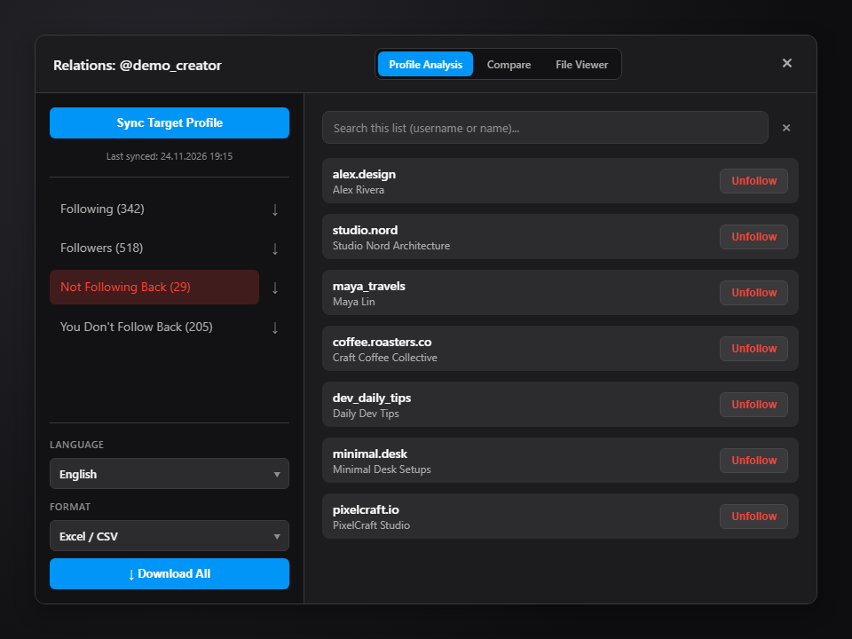
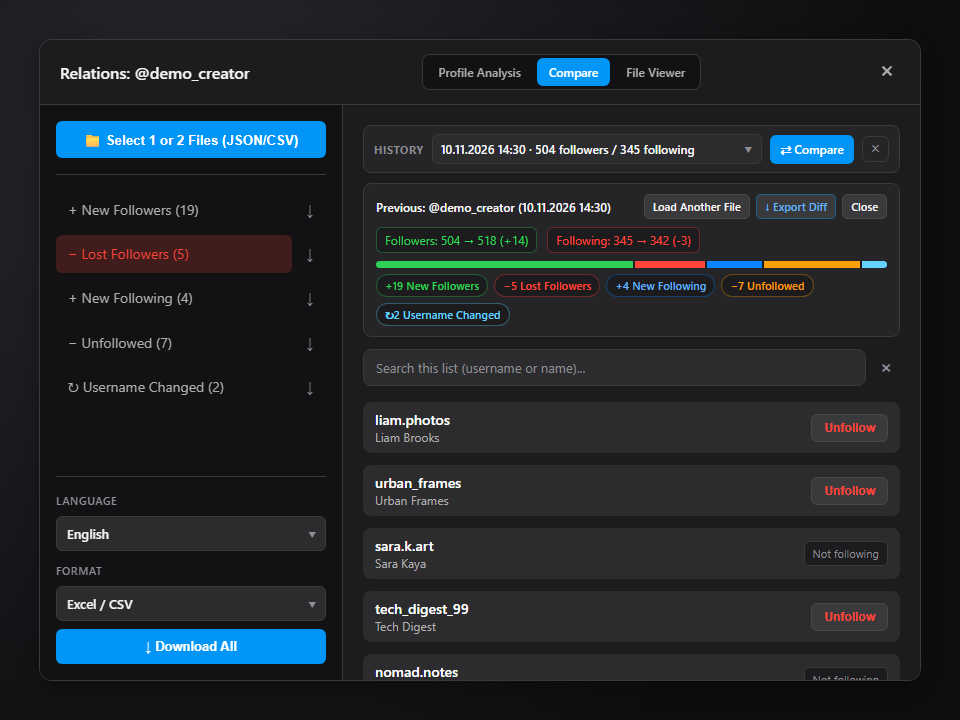

# IG Relations — Analizador de Seguidores

[English](README.md) · [Türkçe](README.tr.md) · **Español**

Una extensión de Chrome ligera y centrada en la privacidad que analiza tus seguidores y seguidos de Instagram enteramente dentro de tu navegador. Sin servidores, sin cuentas, tus datos nunca salen de tu equipo.

  

---

## Capturas de pantalla

| Análisis de Perfil | Comparación e Historial |
|---|---|
|  |  |

---

## Cómo funciona

1. **Tres paneles dedicados** — Alterna entre **Análisis** (sincronización y listas del perfil), **Comparar** (cambios a lo largo del tiempo) y **Visor de Archivos** (inspección sin conexión de archivos JSON/CSV) sin mezclar datos de distintos perfiles.
2. **Detección fiable de perfil** — Resuelve el usuario de la URL a su ID real de Instagram incluso tras navegaciones SPA o en subpáginas como `/reels/` o `/followers/`, evitando cachés desactualizadas.
3. **Historial local (`IndexedDB`)** — Cada sincronización se guarda localmente en el navegador (hasta 20 registros por perfil). Selecciona cualquier fecha anterior en la barra de **Historial** para ver **Nuevos Seguidores**, **Dejaron de Seguirte**, **Nuevos Seguidos**, **Dejaste de Seguir** y **Cambios de Usuario**.
4. **Comparación de archivos JSON y CSV** — Selecciona **1 archivo** para compararlo con el perfil sincronizado, o **2 archivos a la vez** (JSON+JSON, CSV+CSV o JSON+CSV) para compararlos sin conexión con botón **Invertir** y exportación de cambios.
5. **Botón flotante minimizable** — Contrae el botón **📊 IG Relations** en la esquina superior derecha a un icono compacto cuando no lo necesites.

---

## Características

- **Analiza cualquier perfil** — No solo el tuyo: cualquier perfil público, o uno privado que sigas.
- **Cuatro vistas de relación**
  - Siguiendo — todas las cuentas que sigue el perfil
  - Seguidores — todas las cuentas que siguen al perfil
  - No Te Siguen — cuentas que sigue pero que no le devuelven el seguimiento
  - No Sigues de Vuelta — seguidores a los que no sigue de vuelta
- **Búsqueda en vivo** — Filtra la lista abierta al instante por usuario o nombre.
- **Acciones directas** — Deja de seguir o elimina seguidores desde el propio panel.
- **Comparación y visualización (JSON / CSV)** — Compara tus relaciones actuales con cualquier exportación JSON o CSV anterior, abre un solo archivo en modo visor o selecciona dos archivos a la vez para ver Nuevos Seguidores, Dejaron de Seguirte, Nuevos Seguidos, Dejaste de Seguir y Cambios de Usuario.
- **Barra de historial local** — Cada sincronización se guarda automáticamente en `IndexedDB` dentro del navegador (hasta 20 registros por perfil) para comparar cambios con un solo clic.
- **Exportación** — Descarga una lista concreta, las cuatro a la vez o el informe completo de cambios en CSV compatible con Excel o JSON.
- **Caché local** — Los resultados se guardan por perfil en `localStorage`, así que al reabrir un perfil se cargan al instante y se muestra la última sincronización.
- **Multiidioma** — Español, inglés y turco. Detecta el idioma del navegador y se puede cambiar desde el panel.
- **Indicador de progreso** — Contador en vivo, porcentaje y tiempo estimado durante la sincronización.
- **Sin servidores de terceros** — Las peticiones van directamente de tu navegador a Instagram.

---

## Instalación

### Opción A — Descargar una versión publicada (recomendado)

1. Ve a la página de [Releases](../../releases) y descarga `ig-relations-analyzer.zip` de la última versión.
2. Extrae el zip en cualquier carpeta de tu equipo.
3. Abre Chrome y ve a `chrome://extensions/`.
4. Activa el **Modo de desarrollador** (interruptor en la esquina superior derecha).
5. Haz clic en **Cargar descomprimida** y selecciona la carpeta extraída.

### Opción B — Clonar el repositorio

```bash
git clone https://github.com/<tu-usuario>/instagram-relations-analyzer.git
```

Luego sigue los pasos 3–5 anteriores y selecciona la carpeta clonada.

---

## Uso

1. Ve a [instagram.com](https://www.instagram.com) y asegúrate de haber iniciado sesión.
2. Abre cualquier página de perfil (el tuyo o el de otra persona).
3. Haz clic en el botón **📊 IG Relations** en la esquina superior derecha de la página.
4. Pulsa **Sincronizar Perfil** y espera a que termine — el progreso se muestra en vivo.
5. Cambia entre las cuatro listas en la barra lateral, busca dentro de una lista o exporta los resultados.

> **Nota:** Sincronizar un perfil grande lleva tiempo. La extensión espera 1,5 segundos entre peticiones para no superar los límites de Instagram — un perfil con 500 seguidores tarda aproximadamente 1–2 minutos.

---

## Formatos de exportación

| Opción | Resultado |
|---|---|
| **↓ junto a una lista** | Esa lista concreta, en el formato seleccionado |
| **↓ Descargar Todo** | Las cuatro listas en un solo archivo |
| **Excel / CSV** | UTF-8 con BOM; se abre correctamente en Excel, incluidos los caracteres acentuados |
| **JSON** | Datos estructurados con un bloque de resumen, ideal para procesamiento posterior |

Las exportaciones contienen siempre la **lista completa**, sin importar el filtro de búsqueda activo.

---

## Privacidad

Esta extensión realiza peticiones **únicamente** a `instagram.com`, usando tu sesión actual del navegador. No tiene analíticas, ni telemetría, ni endpoints externos. Todos los resultados permanecen en el `localStorage` de tu navegador y puedes borrarlos en cualquier momento limpiando los datos del sitio.

Permisos solicitados:

| Permiso | Motivo |
|---|---|
| `activeTab` | Leer el perfil abierto en la pestaña actual |
| `storage` | Guardar tu preferencia de idioma |
| `https://*.instagram.com/*` | Llamar a los endpoints de Instagram en tu nombre |

---

## Límites de peticiones y seguridad

Instagram aplica límites estrictos a las peticiones y acciones automatizadas. Para mantener tu cuenta a salvo:

- Hay un **retardo de 1,5 segundos** entre peticiones de paginación que no debe reducirse.
- Evita pulsar **Dejar de seguir** o **Eliminar** repetidamente en poco tiempo.
- Sincronizar muchos perfiles externos en un intervalo corto puede provocar restricciones temporales.

Si Instagram te limita, el panel muestra un mensaje claro y se detiene — espera unos minutos antes de reintentar.

---

## Solución de problemas

**"No hay datos guardados"** — Este perfil aún no se ha sincronizado. Pulsa *Sincronizar Perfil*.

**La sincronización se detiene con un aviso de almacenamiento** — La cuota de almacenamiento del navegador está llena. La extensión borra automáticamente las cachés de otros perfiles y reintenta; si aun así falla, la lista permanece visible pero no se conservará al cerrar el panel.

**"Perfil privado o acción bloqueada"** — El perfil es privado y no lo sigues, o Instagram ha bloqueado la petición temporalmente.

**El botón del panel no aparece** — Recarga la pestaña de Instagram. La extensión se inyecta al cargar la página.

---

## Desarrollo

```
src/
├── content.js          # Inyecta el panel en instagram.com
└── ui/
    ├── modal.html      # Marcado del panel
    ├── modal.css       # Estilos del panel
    ├── modal.js        # Lógica: sincronización, comparación, historial, exportación
    ├── compare.js      # Analizador JSON/CSV y motor de diferencias
    ├── history.js      # Historial local en IndexedDB
    ├── profile-url.js  # Analizador de URLs de perfil de Instagram
    └── i18n.js         # Traducciones (en / tr / es)
```

**Añadir un idioma:** agrega un bloque con las mismas claves a `TRANSLATIONS` en `src/ui/i18n.js` y regístralo en el array `LANGUAGES`. El panel lo detecta automáticamente.

Las notas de versión están en [`docs/release-notes/`](docs/release-notes/).

---

## Aviso legal

**Esta herramienta es solo para fines educativos y de análisis personal.** No está afiliada, autorizada, mantenida, patrocinada ni respaldada por Instagram, Meta Platforms, Inc., ni por ninguna de sus filiales o subsidiarias.

Automatizar interacciones o extraer datos de los endpoints web de Instagram puede infringir las Condiciones de Uso de Instagram. Al usar este software reconoces que lo haces **bajo tu propia responsabilidad**. El desarrollador no acepta ninguna responsabilidad por restricciones de cuenta, bloqueos temporales, suspensiones o pérdida de datos derivados del uso de esta extensión.

---

## Licencia

Publicado bajo la Licencia MIT — consulta [LICENCE](LICENCE) para más detalles.
