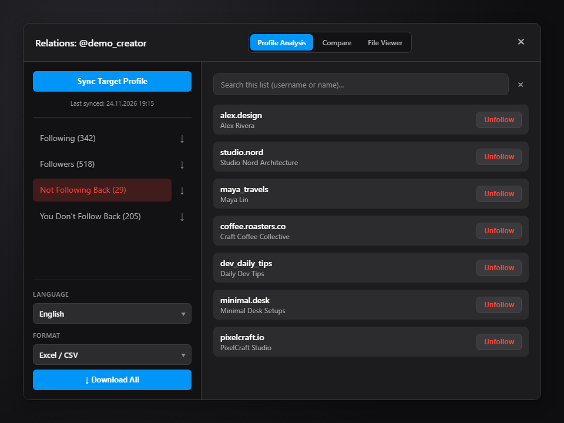
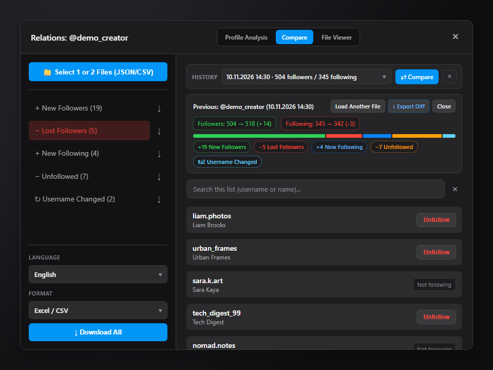
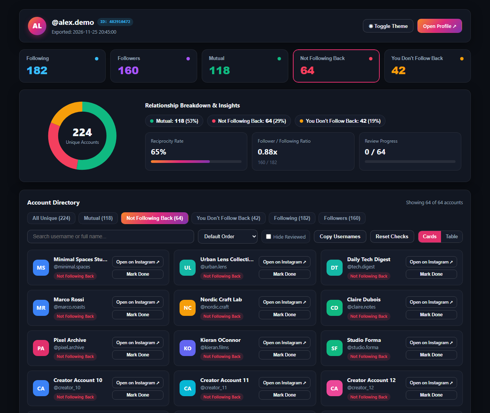

# IG Relations — Follower Analyzer

**English** · [Türkçe](README.tr.md) · [Español](README.es.md)

A lightweight, privacy-focused Chrome extension that analyzes your Instagram followers and following lists entirely inside your browser. No servers, no accounts, no data leaves your machine.

  

---

## Screenshots

| Profile Analysis | Compare & History |
|---|---|
|  |  |

### Interactive HTML Report Export (100% Offline)



---

## How It Works

1. **Three dedicated panels** — Switch cleanly between **Profile Analysis** (live profile sync & lists), **Compare** (diff changes over time), and **File Viewer** (inspect any exported JSON/CSV offline) without mixing profiles.
2. **Authoritative profile resolution** — Resolves the active URL's username to its real Instagram user ID (even across SPA navigations and profile subpages like `/reels/` or `/followers/`) so cached results never leak across profiles.
3. **Browser-local history (`IndexedDB`)** — Every sync is automatically stored locally (up to 20 snapshots per profile). Open the **Compare** tab, pick any previous snapshot from the History bar, and view **New Followers**, **Lost Followers**, **New Following**, **Unfollowed**, and **Username Changes** instantly.
4. **External JSON & CSV compare** — Select **1 file** to compare against your current synced profile, or select **2 files at once** (JSON+JSON, CSV+CSV, or JSON+CSV) to compare them offline with one-click **Swap** and diff export.
5. **Minimizable floating button** — Collapse the top-right **📊 IG Relations** trigger into a compact edge icon whenever you want it out of the way.

---

## Features

- **Analyze any profile** — Not just your own. Any public profile, or any private one you follow.
- **Four relationship views**
  - Following — everyone the profile follows
  - Followers — everyone who follows the profile
  - Not Following Back — people they follow who don't follow back
  - You Don't Follow Back — followers they haven't followed back
- **Live search** — Filter the open list instantly by username or full name.
- **Direct actions** — Unfollow or remove followers straight from the panel.
- **Compare & visualize (JSON / CSV)** — Compare your current relations against any previous JSON or CSV export, open a single file as an offline viewer, or select two files at once to visualize New Followers, Lost Followers, New Following, Unfollowed, and Username Changes.
- **Browser-local history bar** — Every sync is automatically stored locally in `IndexedDB` (up to 20 snapshots per profile) so you can compare against any previous snapshot in one click without leaving the browser.
- **Export (HTML / CSV / JSON)** — Download any single list, all four at once, or full comparison diff reports as a self-contained **Interactive HTML Report** (offline dashboard with donut chart, insights, search, Cards/Table views, dark/light theme, and review checklist), Excel-ready CSV, or JSON. Exported HTML reports also embed the snapshot JSON so they can be re-imported into **Compare** or **File Viewer**.
- **Local cache** — Results are stored per profile in `localStorage`, so reopening a profile loads instantly and shows the last sync time.
- **Multilingual** — English, Turkish and Spanish. Auto-detects your browser language; switchable from the panel.
- **Progress feedback** — Live counter, percentage and estimated time while syncing.
- **No third-party servers** — Requests go directly from your browser to Instagram.

---

## Installation

### Option A — Download a release (recommended)

1. Go to the [Releases](../../releases) page and download `ig-relations-analyzer.zip` from the latest release.
2. Extract the zip anywhere on your computer.
3. Open Chrome and navigate to `chrome://extensions/`.
4. Enable **Developer mode** (toggle in the top-right corner).
5. Click **Load unpacked** and select the extracted folder.

### Option B — Clone the repository

```bash
git clone https://github.com/<your-username>/instagram-relations-analyzer.git
```

Then follow steps 3–5 above, selecting the cloned folder.

---

## Usage

1. Go to [instagram.com](https://www.instagram.com) and make sure you're logged in.
2. Open any profile page (your own or someone else's).
3. Click the **📊 IG Relations** button in the top-right corner of the page.
4. Press **Sync Target Profile** and wait for the sync to finish — progress is shown live.
5. Switch between the four lists in the sidebar, search within a list, or export your results.

> **Note:** Syncing a large profile takes time. The extension waits 1.5 seconds between requests to avoid Instagram's rate limits — a profile with 500 followers takes roughly 1–2 minutes.

---

## Export formats

| Option | Output |
|---|---|
| **↓ next to a list** | That single list, in the selected format |
| **↓ Download All** | All four lists in one file |
| **HTML (Interactive Report)** | Single self-contained offline `.html` dashboard with charts, search, sort, review checklist, dark/light theme, and embedded re-importable JSON |
| **Excel / CSV** | UTF-8 with BOM, opens correctly in Excel including non-English characters |
| **JSON** | Structured data with a summary block, ideal for further processing |

Exports always contain the **full list**, regardless of any active search filter.

---

## Privacy

This extension makes requests **only** to `instagram.com`, using your existing browser session. It has no analytics, no telemetry, and no external endpoints. All results stay in your browser's `localStorage` and can be cleared at any time by clearing site data.

Permissions requested:

| Permission | Why |
|---|---|
| `activeTab` | Read the profile currently open in the tab |
| `storage` | Save your language preference |
| `https://*.instagram.com/*` | Call Instagram's own endpoints on your behalf |

---

## Rate limits & safety

Instagram enforces strict limits on automated requests and actions. To keep your account safe:

- A **1.5-second delay** between pagination requests is built in and should not be reduced.
- Avoid clicking **Unfollow** or **Remove** rapidly in succession.
- Syncing many external profiles in a short window may trigger temporary restrictions.

If Instagram rate-limits you, the panel shows a clear message and stops — wait a few minutes before retrying.

---

## Troubleshooting

**"No cached data found"** — This profile hasn't been synced yet. Press *Sync Target Profile*.

**Sync stops with a storage warning** — The browser's storage quota is full. The extension automatically clears other profiles' caches and retries; if it still fails, the list stays visible on screen but won't persist after closing the panel.

**"Private profile or action blocked"** — The profile is private and you don't follow it, or Instagram has temporarily blocked the request.

**The panel button doesn't appear** — Refresh the Instagram tab. The extension injects itself on page load.

---

## Development

```
src/
├── content.js          # Injects the panel into instagram.com
└── ui/
    ├── modal.html      # Panel markup
    ├── modal.css       # Panel styles
    ├── modal.js        # Panel logic: sync, compare, history, render, export
    ├── compare.js      # JSON/CSV snapshot parser and diff engine
    ├── history.js      # Browser-local IndexedDB snapshot history
    ├── html-export.js  # Self-contained offline interactive HTML report generator
    ├── profile-url.js  # Instagram profile URL parser
    └── i18n.js         # Translations (en / tr / es)
```

**Adding a language:** add a block with the same keys to `TRANSLATIONS` in `src/ui/i18n.js` and register it in the `LANGUAGES` array. The panel picks it up automatically.

Release notes live in [`docs/release-notes/`](docs/release-notes/).

---

## Disclaimer

**This tool is for educational and personal analytical purposes only.** It is not affiliated with, authorized, maintained, sponsored, or endorsed by Instagram, Meta Platforms, Inc., or any of its affiliates or subsidiaries.

Automating interactions with or scraping data from Instagram web endpoints may violate Instagram's Terms of Service. By using this software you acknowledge that you do so entirely **at your own risk**. The developer accepts no responsibility or liability for any account restrictions, temporary action blocks, suspensions, or data loss resulting from the use of this extension.

---

## License

Released under the MIT License — see [LICENCE](LICENCE) for details.
